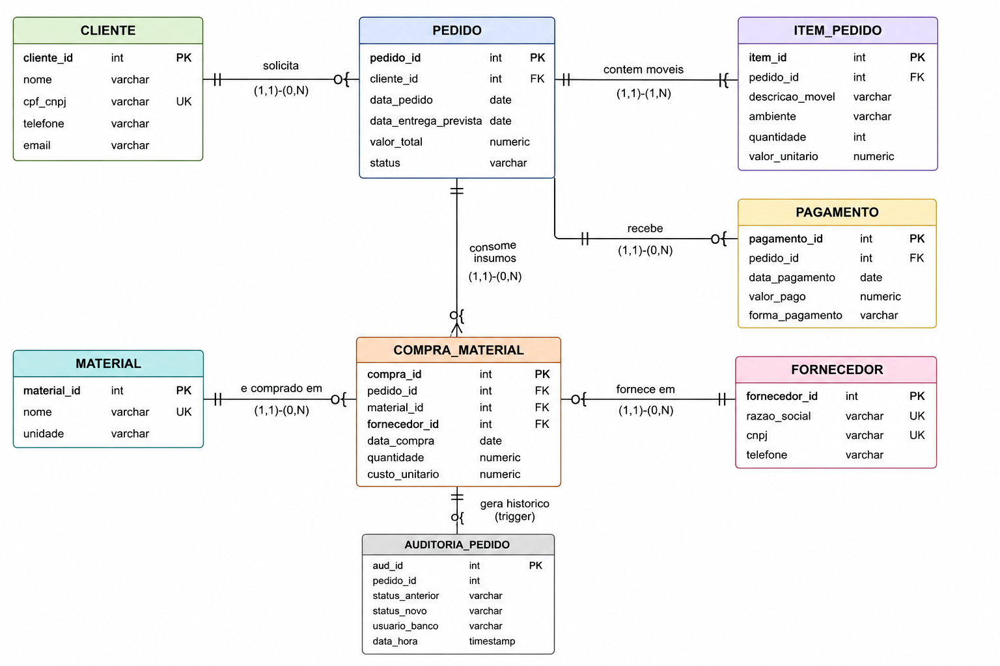
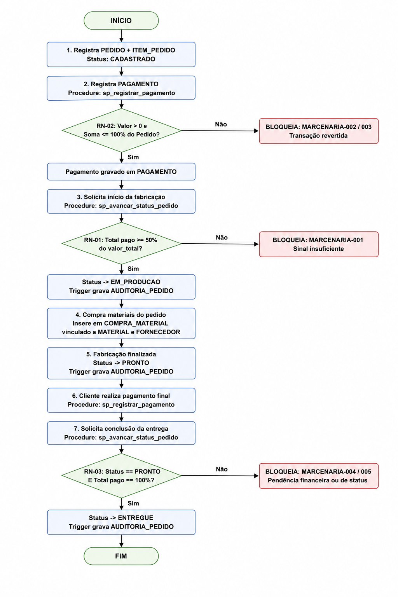

# Projeto A3 — Controle de Encomendas e Pagamentos de uma Marcenaria

Sistema de banco de dados relacional em **PostgreSQL 17** integrado a uma aplicação **Java 21 (JDBC)** para controle ponta a ponta de orçamentos, pedidos sob medida, pagamentos parcelados, compras de insumos e auditoria de produção de uma marcenaria.

---

## 1. Estrutura do Repositório

    a3-marcenaria/
    ├── der/                          # Diagrama Entidade-Relacionamento (DER) e Fluxograma
    │   ├── der_marcenaria.png
    │   └── fluxograma_regras.png
    ├── sql/
    │   ├── 01_ddl.sql                # Criação das 8 tabelas com PK, FK, UK, CHECK e IDENTITY
    │   ├── 02_inserts.sql            # Massa de dados inicial e cenários de fronteira
    │   ├── 03_consultas.sql          # 10 consultas analíticas e operacionais (JOIN, CTE, Window)
    │   └── 04_indices.sql            # Índices estratégicos para filtros de status, prazos e FKs
    ├── procedures/
    │   └── postgresql_procedures.sql # 2 Triggers (auditoria e recálculo) + 2 Procedures (RN-01 a RN-05)
    ├── performance/
    │   └── carga_e_explain.sql       # Benchmark com 20.000 pedidos e EXPLAIN (ANALYZE, BUFFERS)
    ├── java/
    │   ├── pom.xml                   # Projeto Maven com driver PostgreSQL JDBC 42.7.4
    │   └── src/main/java/br/com/marcenaria/Main.java # CRUD completo + testes automatizados das regras
    ├── docker-compose.yml            # Orquestração do PostgreSQL 17 com inicialização automática
    └── README.md

---

## 2. Diagrama Entidade-Relacionamento (DER) e Fluxograma

O banco de dados é composto por **8 tabelas** normalizadas com restrições de integridade nomeadas (`pk_`, `fk_`, `uk_`, `ck_`):

* **`cliente`**: Cadastro de clientes pessoa física ou jurídica (`cpf_cnpj` único).
* **`pedido`**: Encomenda vinculada a um cliente, com datas de pedido/entrega prevista (`ck_pedido_datas`), `valor_total` e ciclo de status (`CADASTRADO`, `EM_PRODUCAO`, `PRONTO`, `ENTREGUE`, `CANCELADO`).
* **`item_pedido`**: Móveis planejados pertencentes a um pedido (ambiente, descrição, quantidade e valor unitário), com exclusão em cascata (`ON DELETE CASCADE`).
* **`pagamento`**: Lançamentos financeiros vinculados ao pedido (`PIX`, `TRANSFERENCIA`, `CARTAO`, `DINHEIRO`).
* **`fornecedor`**: Cadastro de fornecedores de chapas, ferragens e insumos (`cnpj` e `razao_social` únicos).
* **`material`**: Catálogo de insumos utilizados na fabricação (`CHAPA`, `UN`, `M`, `L`, `KG`).
* **`compra_material`**: Registro de compra de materiais associando pedido, material e fornecedor para apuração de custo direto e margem bruta.
* **`auditoria_pedido`**: Trilha histórica imutável de criação e transição de status dos pedidos.
* **Decisões de Modelagem:**
- **`compra_material` como entidade associativa ternária:** resolve o relacionamento N:M entre pedidos, materiais e fornecedores, permitindo registrar `quantidade` e `custo_unitario` histórico para apurar a margem bruta real de cada encomenda.
- **Política de exclusão (`CASCADE` vs. `RESTRICT`):** apenas `item_pedido` utiliza `ON DELETE CASCADE` (excluir um pedido em rascunho remove seus itens); `pedido`, `pagamento` e `compra_material` utilizam `ON DELETE RESTRICT` para proteger o histórico financeiro e fiscal.
- **`auditoria_pedido` desacoplada de FK com cascata:** mantém a trilha imutável de alterações mesmo que registros operacionais sejam arquivados no futuro.

---

## 3. Regras de Negócio Implementadas no Banco

Toda a integridade financeira e operacional é garantida diretamente no SGBD via *Stored Procedures* e *Triggers* (sem `COMMIT` interno, preservando o controle transacional da aplicação):

| Código | Regra de Negócio | Mecanismo no PostgreSQL | Erro em Caso de Violação |
| :--- | :--- | :--- | :--- |
| **RN-01** | Início da produção (`EM_PRODUCAO`) exige pagamento de sinal **>= 50%** do `valor_total`. | `sp_avancar_status_pedido` | `MARCENARIA-001` |
| **RN-02** | Não permite pagamento `<= 0`, em pedido `CANCELADO`/`ENTREGUE`, ou soma **> 100%** do pedido. | `sp_registrar_pagamento` | `MARCENARIA-002` / `MARCENARIA-003` |
| **RN-03** | Entrega (`ENTREGUE`) exige status anterior `PRONTO` e **100% do valor quitado**. | `sp_avancar_status_pedido` | `MARCENARIA-004` / `MARCENARIA-005` |
| **RN-04** | Toda criação ou alteração de status grava histórico imutável em `auditoria_pedido`. | `trg_auditoria_pedido` | Automático (`AFTER INSERT/UPDATE`) |
| **RN-05** | O `valor_total` do pedido é recalculado automaticamente ao inserir/alterar/remover itens. | `trg_atualiza_valor_pedido` | Automático (`AFTER INSERT/UPDATE/DELETE`) |

---

## 4. Como Executar o Projeto

### Pré-requisitos
* **Docker Desktop** em execução
* **Java 17+** e **Maven** (ou IntelliJ IDEA)

### Passo 1: Subir o Banco de Dados (PostgreSQL 17)
Na raiz do projeto (`a3-marcenaria/`), execute:

    docker compose up -d --wait

O container `marcenaria_pg` cria automaticamente as 8 tabelas, instala as triggers/procedures, insere os dados iniciais e aplica os índices.

### Passo 2: Executar as 10 Consultas SQL

    Get-Content sql/03_consultas.sql | docker exec -i marcenaria_pg psql -U marcenaria -d marcenaria

### Passo 3: Executar a Aplicação Java (CRUD + Testes de Fronteira)
Execute a classe `br.com.marcenaria.Main` pelo IntelliJ IDEA ou via terminal Maven:

    mvn -f java/pom.xml compile exec:java -Dexec.mainClass="br.com.marcenaria.Main"

### Resetar o Banco para o Estado Inicial Limpo

    docker compose down -v
    docker compose up -d --wait

---

## 5. Análise de Desempenho (`EXPLAIN ANALYZE`)

Benchmark executado sobre uma carga sintética de **20.000 pedidos** e **20.000 pagamentos** (`performance/carga_e_explain.sql`) filtrando pedidos `EM_PRODUCAO` com entrega prevista nos próximos 7 dias:

| Métrica | Sem Índices Customizados | Com Índice (`idx_pedido_entrega_status`) | Ganho Obtido |
| :--- | :--- | :--- | :--- |
| **Plano de Acesso (`pedido`)** | `Seq Scan` (varredura de 20.005 linhas) | `Bitmap Index Scan` + `Bitmap Heap Scan` | Elimina varredura completa |
| **Tempo na Leitura de `pedido`** | `1.643 ms` | `0.675 ms` | **-58,9% (2,4x mais rápido)** |
| **Custo Estimado (`HashAggregate`)** | `1040.98..1093.01` | `787.10..839.14` | **-24,4% de custo** |
| **Tempo Total de Execução** | `9.070 ms` | `7.919 ms` | **-12,7%** |

---

## 6. Uso do Agente de IA

Em conformidade com os requisitos da disciplina, registra-se abaixo como o agente de Inteligência Artificial Generativa (Google Gemini) foi utilizado como ferramenta de apoio técnico durante o desenvolvimento deste projeto, bem como a validação realizada pela equipe:

| Etapa do Projeto | Apoio do Agente de IA | Validação e Autoria da Equipe |
| :--- | :--- | :--- |
| **Modelagem & DDL (`01_ddl.sql`)** | Revisão da normalização (3FN), nomenclatura de constraints (`pk_`, `fk_`, `uk_`, `ck_`) e política de integridade referencial (`CASCADE` vs. `RESTRICT`). | Definição do domínio da marcenaria, modelagem das 8 entidades, geração dos diagramas e execução limpa no PostgreSQL 17. |
| **Regras de Negócio (`postgresql_procedures.sql`)** | Estruturação sintática em *PL/pgSQL* para triggers de auditoria/recálculo e procedures com controle transacional externo e bloqueio `FOR UPDATE`. | Especificação das regras `RN-01` a `RN-05` e validação prática dos cenários de fronteira (`MARCENARIA-001` a `005`). |
| **Consultas & Performance (`03_consultas.sql`, `carga_e_explain.sql`)** | Apoio na escrita de CTEs, Window Functions (`SUM() OVER`, `RANK() OVER`) e geração da carga sintética de 20.000 registros. | Execução local das 10 consultas, medição real dos planos no `EXPLAIN (ANALYZE, BUFFERS)` e interpretação dos ganhos. |
| **Aplicação Java (`Main.java`) & Docker (`docker-compose.yml`)** | Estruturação do cliente Maven/JDBC (`PreparedStatement` e `CallableStatement`) e orquestração do container PostgreSQL 17. | Integração ponta a ponta no IntelliJ IDEA, depuração dos fluxos CRUD e conferência dos logs de execução. |
| **Documentação (`README.md`)** | Organização estrutural da documentação técnica e revisão textual. | Revisão integral do conteúdo, inserção dos diagramas e domínio técnico para a defesa oral. |
### Conclusão Técnica do Benchmark
Com o índice composto `idx_pedido_entrega_status (status, data_entrega_prevista)`, o otimizador substituiu o `Seq Scan` na tabela `pedido` por um `Bitmap Index Scan` seguido de `Bitmap Heap Scan`, reduzindo em **58,9%** o tempo de filtragem dos 4.108 pedidos elegíveis. Na junção com `pagamento`, o SGBD manteve `Seq Scan` + `Hash Join` por ser estatisticamente mais eficiente do que milhares de buscas aleatórias de índice quando ~20% da tabela é retornada.